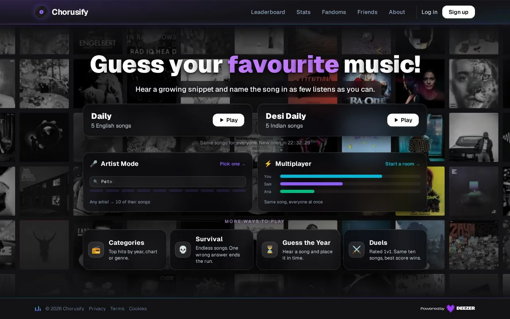
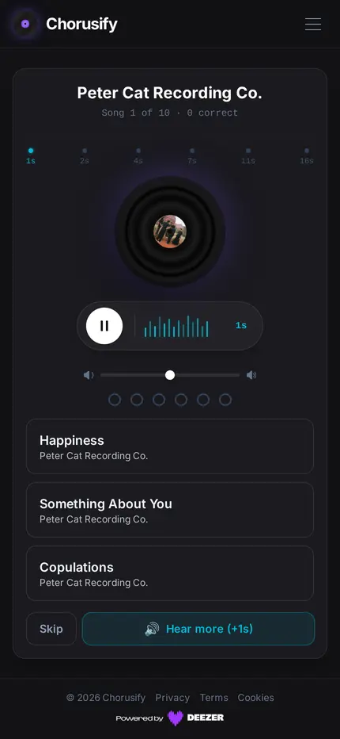

<div align="center">



# Chorusify

**Guess your favourite music, a second at a time.**

[Play it](https://chorusify.com) · [Futile Studio](https://futile.studio)


</div>

> **Futile Studio · FS-001** · Games, music game · Live, started in 2023

> _For everyone who's ever finished a lyric before the singer did. For the ones who know a song from its first half-second. For the stans, the superfans, the ones who know the deep cuts too. This one's for you._

## Overview

Chorusify plays you a tiny slice of a song and you guess what it is. If you miss, you hear a bit more: `1s, 2s, 4s, 7s, 11s, 16s`. The music comes from Deezer's 30 second previews, and the song bank holds a few thousand originals (see [docs/SONG-BANK.md](docs/SONG-BANK.md)).

<p align="center"> </p>

## Modes

**Daily.** One song. Dropped at midnight UTC. The whole world guesses the same track, at the same time. Did you nail it before your friends woke up?

**Artist.** Pick a discography, any discography, and go 10 rounds deep. Type it out from memory or pick from the lineup. Real leaderboards, per artist, for the true completionists.

**Categories.** Top hits by year (2000 to 2025), genre (Pop, Rock, Rap, K-Pop, Bollywood...), or the worldwide chart. Hundreds of playlists.

**Multiplayer.** Up to 8 in a room, real time, no sign-up. Songs unfold second by second, and _you_ decide how much you need to hear before you buzz in. Phones near the host can also join by sound: the host plays an ultrasonic frame with the room code and the phones decode it.

**Survival.** One song after another, no end in sight, until the one that finally gets you. How deep does your crate go?

**Guess the Year.** Hear a song and place it in time. How well do you know your decades?

**Duels.** Rated 1v1. Both players get the same ten songs. Elo ratings, global leaderboard.

**Events.** Approved hosts run a live game from their own playlist, for up to 1,000 players by QR code. Music on every phone or through the venue speakers, with a big screen view for the projector. See [how it works](docs/ARCHITECTURE-EVENTS.md) and the [load test](docs/LOAD-TEST.md).

_Karaoke covers, live cuts and remixes don't make the bank. Originals only!!_

## Fandoms

Join your favourite artist's fandom and earn your place on the leaderboard. Every challenge you complete earns fan score, which sets your tier.

Collect interactive cards with holographic effects and media decorations, and download them as PNGs. Eight tiers: **Diamond** · **Platinum** · **Gold** · **Silver** · **Bronze** · **Fan** · **Listener** · **Newcomer**

## Stack

```
apps/web     React 19 · Vite · TypeScript · Tailwind CSS · Motion
apps/server  Express 5 · TypeScript · PostgreSQL · Drizzle ORM · postgres.js
realtime     WebSockets (ws), same origin, session authenticated
music data   Deezer API, 30s previews
infra        Docker image (GHCR) · Coolify · Caddy reverse proxy
```

Sound joining uses a vendored copy of my knock-audio library (MIT), in `apps/web/src/vendor/knock`.

## Running it locally

You need Node and a running Postgres with an empty `chorusify` database.

```bash
npm install
cp apps/server/.env.example apps/server/.env
openssl rand -hex 32          # run twice: SESSION_SECRET and CSRF_SECRET

npm run -w apps/server db:migrate
npm run curate:songs
npm run dev                    # api :8888, web :5174
```

For the web app, copy `apps/web/.env.example` to `apps/web/.env.local`.

| Script                | What it does                          |
| --------------------- | ------------------------------------- |
| `dev`                 | frontend + backend, watch mode        |
| `build`               | production build                      |
| `lint` / `typecheck`  | keep the code in tune                 |
| `test`                | full suite, isolated `_test` database |
| `curate:songs`        | stock the crate from Deezer           |
| `reverify:songs`      | make sure every track still plays     |
| `change-daily-puzzle` | swap today's daily song               |
| `song-bank`           | song bank reports                     |

## Configuration

Server (`apps/server/.env`, checked by `apps/server/src/env.ts` on boot):

| Variable                  | Purpose                                                                     |
| ------------------------- | --------------------------------------------------------------------------- |
| `NODE_ENV`                | `development`, `test` or `production` (defaults to production)              |
| `PORT`                    | API port, default `8888`                                                    |
| `DATABASE_URL`            | `postgres://` connection string. The database must already exist           |
| `SESSION_SECRET`          | signs session cookies, at least 32 characters                               |
| `CSRF_SECRET`             | signs CSRF tokens, at least 32 characters                                   |
| `CORS_ORIGIN`             | comma separated frontend origins. Needed in dev, empty when same origin     |
| `ADMIN_EMAIL`             | the one admin account. Unset means nobody is admin                          |
| `ADMIN_REGISTRATION_OPEN` | `true` only while you create the admin account, then set it back to `false` |

Web (`apps/web/.env.local`): `VITE_API_URL`, the API base. Use `/api` when the frontend and API share an origin.

## Deploy

Set `DATABASE_URL`, ship it. Migrations run automatically on boot.

```bash
npm run build:full && npm start
```

The `Dockerfile` builds the web app into the server and runs both from one Node process. CI pushes the image to GHCR and Coolify runs it with `deploy/compose.yaml`. The frontend also ships standalone to Vercel, Netlify or Cloudflare Pages, if you'd rather split the set.

## Security

Argon2id · opaque server-side sessions · double-submit CSRF · rate limiting · Zod validation · Helmet + CSP

## Credits

Music previews and metadata come from [Deezer](https://www.deezer.com). The app shows the "Powered by Deezer" mark as their brand guidelines ask.

## Licence

No licence file yet, all rights reserved. The vendored knock-audio code in `apps/web/src/vendor/knock` is MIT (licence alongside it).

---

<p align="center">
  <a href="https://futile.studio"></a>
  <br>
  <sub>Built by <a href="https://github.com/MayurJivani">Mayur Jivani</a>. Everything is futile. Do it anyway.</sub>
</p>

<div align="center">

**Built with ❤️ and 🎵**

</div>
